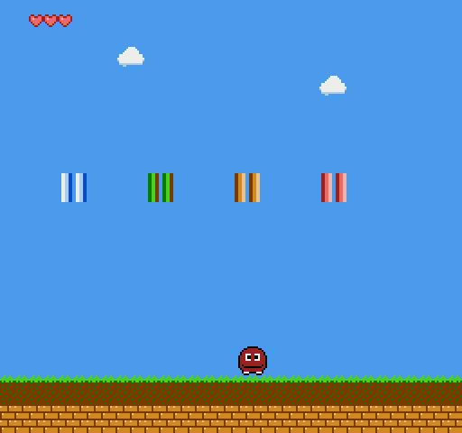

# Hello CHR — gráficos no NES com Assembly 6502 (ca65 + NEXXT + Mesen)

Projeto didático: mostra, a partir do zero, como **bits viram pixels** no NES.
Tem fundo com paletas e atributos, um herói 16×16 feito de 4 sprites, NMI, DMA da OAM e tudo comentado
**linha a linha** (efeito em A, X e Y).

> A imagem acima é uma **pré-visualização** gerada por um simulador de verificação, não uma captura do Mesen;
> as cores podem ficar um pouco diferentes no emulador.

## Comece por aqui

1. Leia **[`TUTORIAL.md`](TUTORIAL.md)** (aulas 0–14).
2. Compile e rode:

   | Sistema | Comando | Resultado |
   |---|---|---|
   | Linux / macOS / WSL | `make` | `build/hello_chr.nes` |
   | Windows | `build.bat` | `build\hello_chr.nes` |

   Precisa do **cc65** (`ca65`, `ld65`) no `PATH`. Abra a ROM no **Mesen**.
3. Usar a arte exportada do **NEXXT**: salve em `gfx/` (`tiles.chr`, `scene.nam`, `bg.pal`, `spr.pal`) e rode
   `make nexxt` (ou `build.bat nexxt`) → `build/hello_chr_nexxt.nes`.

## Arquivos

| Arquivo | Para quê |
|---|---|
| `src/main.asm` | o programa (reset, paletas, nametable, herói, NMI) — **toda linha comentada** |
| `src/nes.inc` | nomes dos registradores da PPU/APU e dos bits de controle |
| `src/chr_bg.inc`, `src/chr_spr.inc` | tiles **em binário** (com o desenho em comentário) |
| `src/palette.inc`, `src/scene.inc` | 32 bytes de cores; nametable + atributos |
| `nes.cfg` | mapa de memória do cartucho (NROM, 32 KB PRG + 8 KB CHR) |
| `gfx/*` | os mesmos dados em binário, para abrir/editar no NEXXT |
| `tools/chr_dump.py` | mostra um tile do `.chr` em bits (`python tools/chr_dump.py gfx/tiles.chr 9`) |
| `docs/` | `preview.png` (tela esperada), `chr_sheet.png` (tiles de cada tabela), `rom_de_conferencia.nes` (ROM esperada: abra no Mesen mesmo sem o cc65; depois compare com a sua via `cmp`/`fc /b`) |

## Regras de código deste projeto

* **Sem `SED`/`CLD`:** o 2A03 do NES não tem modo decimal.
* **Variáveis na Zero Page**, declaradas **antes** do código que as usa.
* **Todo comando comentado** dizendo o que acontece com A, X e Y.

## Estado da verificação

Compilado e executado em um **simulador próprio de verificação** (ver "Limites da verificação" no fim do
`TUTORIAL.md`). O `ca65`/`ld65`/Mesen reais **não estavam disponíveis** no ambiente de preparação: se algo falhar
na sua primeira compilação, cole a mensagem de erro completa.
